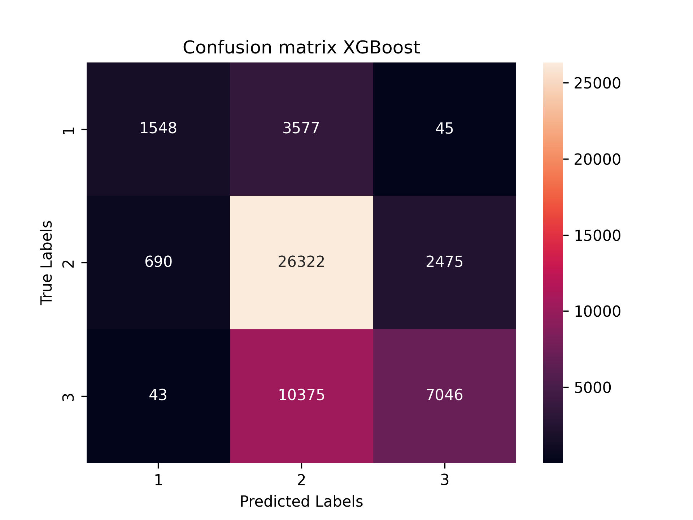

# Earthquake Damage Prediction



Predicts the **damage grade** (1 = low, 2 = medium, 3 = near complete destruction) of buildings hit by the **2015 Gorkha earthquake in Nepal**, based on structural and geospatial features.
It follows the DrivenData ["Richter's Predictor: Modeling Earthquake Damage"](https://www.drivendata.org/competitions/57/nepal-earthquake/) competition and implements an end-to-end workflow: preprocessing, Random Forest and XGBoost models, Bayesian hyperparameter optimization and MLflow experiment tracking.

## Problem

On April 25, 2015, a magnitude 7.6 earthquake struck the Gorkha region of Nepal, causing damage and economic losses estimated at $7 billion.
Given 38 attributes per building (location hierarchy, age, floors, footprint, foundation, roof and superstructure materials, ownership, secondary use), the task is a three-class classification of the damage grade. The competition metric is the **micro-averaged F1 score**.

## Approach

- **Preprocessing** (`src/preprocess.py`): one-hot encoding of categorical features, train/validation split (80/20), alignment of train and test feature columns, outlier filtering and SMOTE helpers.
- **Models** (`src/modeling/train.py`): scikit-learn pipelines with a `StandardScaler` and a Random Forest or an XGBoost classifier.
- **Tuning**: Bayesian optimization with `scikit-optimize` (`BayesSearchCV`), 3-fold cross-validation, micro-F1 as the objective.
- **Tracking**: every search is logged to MLflow (metrics, best parameters, search space, CV results, best model).
- **Submission** (`src/modeling/predict.py`): encodes the competition test set, aligns it to the training features and writes the submission file.

## Results

| Model | Micro-F1 (Val) | Micro-F1 (Test) | Rank (Competition) |
| :--- | :---: | :---: | :---: |
| Random Forest (tuned) | 0.739 | 0.7397 | 963 / 2258 |
| **XGBoost (tuned)** | **0.744** | **0.7444** | **710 / 2258** |

The best model is XGBoost with Bayesian hyperparameter tuning. The most informative features are the `geo_level_*_id` location identifiers, followed by structural attributes such as foundation and roof type.
The notebooks ship with small search spaces so a run finishes quickly; the wider spaces used for tuning are kept as comments next to them, and scores of a quick run can differ from the table.

More figures are in [`reports/figures`](reports/figures): confusion matrices, feature importances, optimization plots and data exploration plots.

## Challenges

- **Class imbalance:** `damage_grade` is dominated by class 2, which reduces recall for the minority classes.
- **Feature alignment:** category levels differ between train and test sets, which causes column mismatches after one-hot encoding. `preprocess.align_features` adds missing columns as zeros, drops unseen ones and fixes the column order.
- **Outliers:** extreme values (e.g. buildings aged 995 years) complicate preprocessing without improving performance.
- **High dimensionality:** one-hot encoding creates many features, which increases model complexity and training time.
- **Optimization complexity:** Bayesian tuning improved results but required careful search space design.
- **Interpretability vs. performance:** XGBoost is more accurate but less interpretable than Random Forest.

## Project structure

```
├── .github/workflows/ci.yml   <- Lint (ruff) and tests on pull requests and pushes to main
├── Makefile                   <- Shortcuts: requirements, lint, format, test, interim
├── pyproject.toml             <- Dependencies (Poetry), ruff and pytest configuration
├── data/                      <- Local only, git-ignored; see "Data" below
│   └── raw/competition/       <- train_values.csv, train_labels.csv, test_values.csv, submission_format.csv
├── models/                    <- Generated submission files (git-ignored)
├── notebooks/
│   ├── data_understanding.ipynb  <- Exploration, quality checks, outlier analysis
│   ├── random_forest.ipynb       <- Random Forest: tuning, evaluation, submission
│   └── xgboost.ipynb             <- XGBoost: tuning, evaluation, submission
├── reports/figures/           <- Saved plots used in this README
├── src/
│   ├── config.py              <- Paths and environment loading
│   ├── dataset.py             <- Loaders and merge helpers, CLI for interim Parquet files
│   ├── preprocess.py          <- Encoding, split, feature alignment, outliers, SMOTE
│   └── modeling/
│       ├── train.py           <- Pipelines and Bayesian optimization
│       └── predict.py         <- Submission file creation
└── tests/                     <- Unit tests on small synthetic data
```

## Getting started

### Setup

Requires Python 3.10 - 3.12 and [Poetry](https://python-poetry.org/).

```bash
git clone https://github.com/joscha-hillienhoff/earthquake-damage-ml.git
cd earthquake-damage-ml
poetry install
```

### Data

The competition data is **not** part of this repository and is not redistributed.
Register for the [competition on DrivenData](https://www.drivendata.org/competitions/57/nepal-earthquake/data/), accept its terms, which apply to any use of the data, and download the training values, training labels, test values and submission format.
Place the files like this (the `data/` folder is git-ignored):

```
data/raw/competition/train_values.csv
data/raw/competition/train_labels.csv
data/raw/competition/test_values.csv
data/raw/competition/submission_format.csv
```

`notebooks/data_understanding.ipynb` additionally compares the competition data with the original Nepal Post-Earthquake Building Damage tables (`csv_building_damage_assessment.csv`, `csv_building_structure.csv`, `csv_building_ownership_and_use.csv`) from the [2015 Nepal Earthquake Open Data Portal](https://eq2015.npc.gov.np/); place them in `data/raw/original/` to run that comparison. Training does not need them.

### Train and predict

Training, evaluation and prediction run in the notebooks. Each model notebook tunes the model, logs the run to MLflow, saves its figures to `reports/figures/` and writes a submission file to `models/`.

```bash
# interactive
poetry run jupyter lab

# or headless; the executed copy is written outside the repository
poetry run jupyter nbconvert --to notebook --execute notebooks/xgboost.ipynb --output-dir /tmp/runs
poetry run jupyter nbconvert --to notebook --execute notebooks/random_forest.ipynb --output-dir /tmp/runs
```

The notebooks write `models/submission_xgb_test.csv` and `models/submission_rf_test.csv`, which can be uploaded to the competition page.
Executing a notebook overwrites the matching figures in `reports/figures/`.

To only merge the competition train values and labels into Parquet files (`data/interim/`):

```bash
poetry run python -m src.dataset
```

### Experiment tracking

MLflow tracking is **local by default**: runs are stored in `notebooks/mlruns`, browse them with

```bash
poetry run mlflow ui --backend-store-uri notebooks/mlruns
```

Logging to a DagsHub-hosted MLflow server is optional. Install the extra, authenticate (DagsHub prompts for a token on first use) and point the notebooks to your repository:

```bash
poetry install --extras dagshub
export DAGSHUB_REPO=<owner>/<repo>
poetry run jupyter lab
```

No credentials are stored in this repository.

### Tests and linting

```bash
poetry run pytest
poetry run ruff check .
poetry run ruff format --check .
```

The same checks run in GitHub Actions on pull requests and pushes to `main`.

## Technologies

Python, pandas, scikit-learn, XGBoost, scikit-optimize, imbalanced-learn, MLflow (DagsHub optional), Typer, Poetry, ruff, pytest.

Configuration is plain Python in `src/config.py`; [Hydra](https://hydra.cc/) is not used.

## Possible improvements

- Introduce Hydra for structured configuration management.
- Use Optuna for a more efficient hyperparameter search.
- Add a command-line entry point for training and prediction next to the notebooks.
- Add model explainability (e.g. SHAP) to balance performance and interpretability.

## License

MIT, see [LICENSE](LICENSE). The competition data is subject to the competition's own terms.
